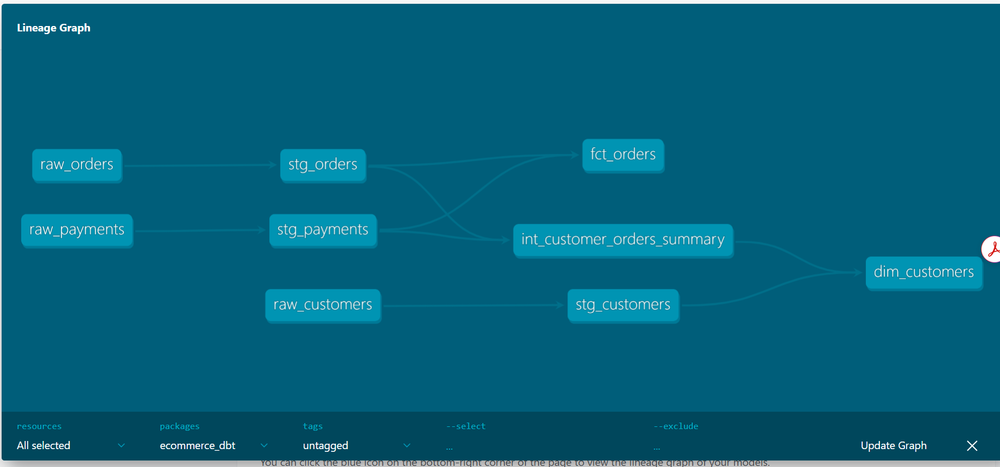

# Production-Ready E-Commerce Analytics Engineering Pipeline (dbt + DuckDB)

An end-to-end data transformation pipeline built using **dbt (data build tool)** and **DuckDB**, implementing Kimball dimensional modeling, automated schema testing, and incremental processing.

---

## Data Lineage Graph (DAG)



---

## Architectural & Design Decisions

### 1. Staging Models Materialized as Views
* **Storage Optimization:** Staging models (`stg_customers`, `stg_orders`, `stg_payments`) perform 1:1 standardization (type casting, column renaming, whitespace trimming). Storing them as views avoids duplicating raw data on disk.
* **Freshness:** Downstream models querying staging views always reflect the most recent state of the underlying source tables without requiring intermediary rebuild steps.

### 2. Incremental Processing for `fct_orders`
* **Compute Cost & Scalability:** Rather than executing an expensive full-table rebuild (`CREATE OR REPLACE TABLE`) on every run, `fct_orders` uses `materialized='incremental'` with an `is_incremental()` macro gate.
* **Execution Strategy:** On the initial run, the model processes historical records. On subsequent executions, it filters only transactions where `order_date` is greater than or equal to the maximum `order_date` currently stored in the destination table (`{{ this }}`), reducing I/O and compute time.

### 3. Intermediate Layer Materialized as Ephemeral
* **Warehouse Cleanliness:** `int_customer_orders_summary` handles pre-aggregations and metric calculations. Setting this layer to `ephemeral` injects the transformation logic directly as a Common Table Expression (CTE) into downstream models, preventing temporary reporting tables from cluttering the schema.

### 4. Data Quality Gates & Failure Prevention
To prevent silent pipeline failures, data contracts and schema tests are enforced in `_marts__models.yml`:
* **Primary Key Integrity:** `unique` and `not_null` assertions on `customer_id` and `order_id` prevent duplicate transactions from distorting revenue metrics.
* **Referential Integrity:** A `relationships` test validates foreign keys between `fct_orders.customer_id` and `dim_customers.customer_id`, ensuring orphaned orders cannot skew lifetime value calculations.

---

## Project Structure

```text
ecommerce_dbt/
├── macros/
│   └── cents_to_dollars.sql
├── models/
│   ├── staging/
│   ├── intermediate/
│   └── marts/
├── seeds/
│   ├── raw_customers.csv
│   ├── raw_orders.csv
│   └── raw_payments.csv
├── dbt_project.yml
└── profiles.yml